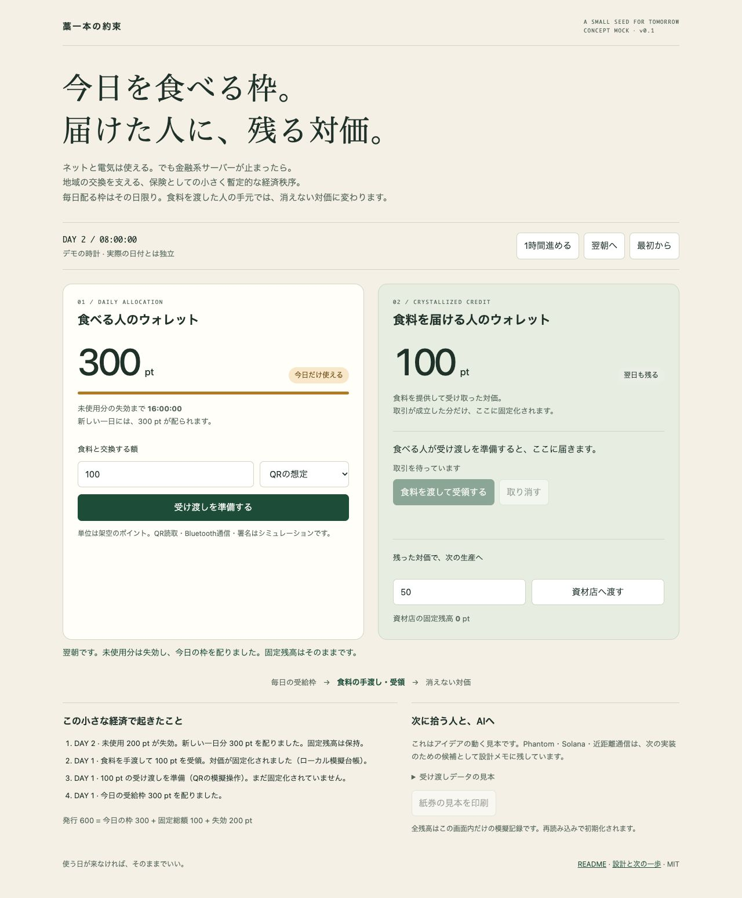

# 藁一本の約束 — Emergency Straw Protocol

**今日を生きる分は、誰にでも。届けた人には、残る対価を。**

**Every person receives the means to eat today, unconditionally. An enduring credit remains with the person who feeds them.**

EDT–CPC: Ephemeral Daily Token → Crystallized Producer Credit.

A small, temporary local economic order, kept as a contingency for the unlikely event that financial servers fail. Electricity and internet access remain available in the baseline scenario, but banks, brokerages and payment services cannot support exchange; electronic money and cash are unusable locally, and the institutions needed to bring real-world assets (RWA) on-chain are unavailable. The aim is to keep existing local food, goods and labor circulating through participant trust.

Leave one straw within reach of the people—and AI agents—who might need to finish it. If that day never comes, it can simply remain here.

**Status: v0.2, Devnet implementation + original offline concept mock.** The new app implements Phantom signing and a native Solana program, tested locally with LiteSVM. Deployed on public Devnet, with the full 120-second day cycle verified on-chain. Merchant checkout QR v2 supports automatic receipt confirmation against confirmed Devnet transactions. The current payment flow needs only the consumer's signature; merchant countersigning and return QR codes have been removed. Earlier Brave checks of the two-signature flow are historical; see the verification scope in DEVNET.md. [Devnet setup and verification status](DEVNET.md) · [日本語の設計・制作意図](DESIGN.md).

The agreed issuance rule is **cumulative daily Kusa spending ≤ 300, with WARA minted only when a payment is accepted**. Unused allowance is an expiring right, never pre-minted supply. Earned producer credit persists. The Devnet prototype enforces this per wallet; unique-person enrollment remains future work.



## 一つのウォレット、KusaとWARA

翌日も残る本トークン（生産者クレジット）の名前は **WARA**。深い緑に金色の藁が輪を描くアイコンを使います。日次枠の名前は **Kusa（草）**。毎日300 Kusaまで使え、未使用分は翌日に繰り越しません。100 Kusaを使う支払いが成立すると、相手に100 WARAを新規発行します。Kusaは送金可能な仮トークンやSPLトークンではなく、チェーン上で管理する購入用の権利の表示名です。

**ウォレットは一つで、Kusaを使う・WARAを受け取る・WARAで支払う、のすべてを行います。** 消費者用と生産者用に財布を分けず、生産者も同じKusaの枠を使えます。サイトによるウォレット新規発行や鍵の預かりは実装せず、現在はPhantomで接続します。

English: **Kusa** names the expiring daily allowance; **WARA** is the enduring SPL token. One wallet supports both roles. Kusa is not a separately minted or transferable token. Unique-person enrollment and community verification are future work.

Devnetでは通常版を **WARA Devnet / WARA**、120秒体験版を **WARA Devnet Demo / WARA-DEMO** と区別します。どちらも金銭的価値のないテストトークンです。[画像・メタデータの設計と確認方法](TOKEN-METADATA.md)。

2026-11-07：既存の両Mintへ名前・画像を登録済み。通常版はPhantomでもアイコン付きの「WARA Devnet」と既存の90 WARA残高を確認しました。

## 紹介文：体験してみませんか？

🌾 **藁一本の約束 — 体験してみませんか？**

金融システムが止まった時にも、地域で食料や物資を交換できるようにする、小さな経済の実験です。

一つのウォレットで、性質の違う二つを使い分けます。

- **Kusa（毎日の購入枠）：** 毎日300に更新される購入用の権利。繰り越しや送金はできません。100の買い物が成立すると、枠が100減り、相手に100の本トークンが新しく発行されます。
- **WARA（残る本トークン）：** 取引で受け取った、翌日も残る対価。次の買い物にも使え、その場合は新規発行せず、相手へ移動します。

どちらもSolanaのブロックチェーン上で管理します。Webアプリは操作の窓口で、本トークンは対応する別アプリからも送れます。

**店側のお会計QRを読み、買う人が支払い方法を選んでPhantomで署名。店側はQR画面を開いて待つだけ。着金すると「100 WARA受け取りました」と自動表示されます。** PCのPhantomと無料のDevnet SOLを用意し、二人で画面の案内に沿って試せます。「120秒を一日」の設定なら、枠の更新とトークンが残る様子を短時間で体験できます。実際のお金や商品は使いません。

👉 [藁一本の約束を試す](https://straw-promise-devnet.kentaroid.chatgpt.site/)

**現在はウォレットごとに1日300です。同じ人による複数ウォレットの利用は防いでおらず、一人一日300にする仕組みは今後の課題です。**

ウォレットなしの説明用モックもあります。触ってみて、分かりにくかったところを教えてもらえるとうれしいです。

## 現在の上限と今後の課題：一人一日300へ

**現在のDevnet版は、同じ循環設定につき「1ウォレットに1日300」です。「一人に1日300」を保証する仕組みは、まだありません。** 同じ人が3つのウォレットを登録すれば、合計900の枠を使えます。登録だけで本トークンを発行することはなく、買う人が署名した支払いがチェーン上で成立した分だけ発行します。120秒体験版では、この「1日」を120秒として扱います。

目指すのは、すべての人に一人一日300の枠を届けることです。今後は人とウォレットを分けて管理し、同じ人の複数ウォレットに共通の使用上限を適用する必要があります。同じ人の重複登録を防ぐこと、ウォレットの紛失・交換でも使用履歴を引き継ぐことが課題です。

具体的な本人の重複確認方式は、まだ採用・実装していません。書類やスマートフォンを持たない人にも利用できる経路を考えます。確認の目的は同じ人への重複発行を防ぐことであり、所得・資産・就労・困窮の証明によって受給資格を選別することではありません。

## 今後の構想：地域の人同士で、一人一日300を支える

**これは未実装の構想です。現在のDevnet版は引き続きウォレットごとの上限で動きます。**

本人が目指すのは、銀行や行政の認証サーバーに頼らず、地域の人同士で確認し合い、誰もが一人一日300を使える仕組みです。地域の人が「実在する一人で、重複登録していないこと」を確認し、ブロックチェーンが登録ごとの累計使用額を管理する分担を考えます。現在のSolana構成を延長する場合、電気・ネット・利用可能なSolanaとRPCへの接続は必要です。

### 対話から整理した設計案

1. **複数人による登録確認。** 対面の受付などで複数の確認役が実在と地域内の既存登録を確認し、登録内容に署名します。「3人の確認」は試験用の例であり、必要人数・確認役の選出・最初の確認役の登録方法は未決定です。
2. **一人・一登録のKusaアカウントを基本にする。** 参加者IDにKusaの日次使用額を紐づけ、消費者本人にはウォレットや秘密鍵の管理を必須にしません。WARAを受け取り・保有・送信する場合にウォレットを結び付け、受給用と生産者用の二つの財布は作りません。カードや財布を追加・交換しても一人の上限は増やさず、同一人物による別IDの取得は地域での重複確認によって防ぐ必要があります。
3. **紛失時も使用額を引き継ぐ。** 複数人による再確認で、新しいウォレットを同じ登録へ紐づけ、古いウォレットの日次枠利用権限を解除します。その日の使用額は保持し、復旧による追加の300は発生させません。本トークンの残高は別管理であり、この登録復旧だけで紛失した秘密鍵や本トークンを取り戻せるわけではありません。
4. **毎日の承認を不要にする。** 登録後はチェーンの日時から日次枠を更新し、確認役に毎朝頼む必要をなくします。日次枠を使った支払いの成立時だけ、相手に同額の本トークンを発行するルールを保ちます。

確認の目的は重複登録を防ぐことです。所得・資産・就労・困窮の証明を求めず、生産者や本トークンを持つ人にも同じ日次枠を届けます。

登録時に約15分の質問や練習を設ける案は、操作の理解と対面確認の時間として検討します。時間をかけるだけでは一人一登録を保証できないため、正誤で受給資格を決めず、時間制限だけに重複防止を任せません。同一IP・地域差は補助的な確認材料にとどめ、家族・避難所の共有回線や避難・転居だけを理由に拒否しない方針です。これらの受付・照合も未実装です。

### 成立に向けて検証すること

署名が複数集まることは、確認役が承認した証拠です。それだけで世界全体に重複登録がないとは証明できません。次の課題を、運用とプロトコルの両方で詰めます。

| 課題 | 検討する対応 |
|---|---|
| 確認役の結託・架空登録・権限の集中 | 確認役の選出と交代、相互点検、不正登録の再審査手順を設計する |
| 別地域での二重登録 | 地域間で既存登録を照合・引き継ぐ方法を決める。移住時にも使用額を保持し、新旧の登録が同時に枠を使えないようにする |
| 知り合いがいない人、移動できない人の参加 | 紹介者なしの対面受付、訪問確認、誤った拒否を見直す窓口を用意する。書類やスマートフォンを持たない人の利用経路も検討する |
| 個人情報と関係性の保護 | 氏名・住所・顔写真を公開チェーンに載せず、必要最小限の登録情報を扱う。ID・署名・取引の関連から人間関係が推測されるリスクも点検する |

先行例として、人のつながりから一人一アカウントの確認を目指す[BrightIDの公式説明](https://www.brightid.org/about)を参照できます。本プロジェクトでの採用・接続はしていません。

最初のPoC候補は、一つの地域を想定したDevnet上の登録・復旧の試験です。同じ登録で200 Kusaを使用してウォレットを交換しても残りは100 Kusaのままであること、旧ウォレットからの利用や重複登録による追加の300を拒否すること、翌日には枠が更新されることを確認します。地域での重複確認と参加しやすさは、別途、対面運用の試験で確かめます。**誰もが今日を生きる300を、人同士の確認で支える**ことを次の検証の中心に置きます。

## 今後の構想：WARAの発行元とコミュニティごとの受け入れ

以下は未実装の方針です。**WARAは何度支払いに使っても、最初に発行したコミュニティを識別できます。** たとえば、A地区発行の100 WARAを受け取ったB地区の人が、そのうち30 WARAをC地区の店で使うと、店が受け取る30 WARAもA地区発行です。

どの発行元を受け入れるかは、受け取る側のコミュニティが決めます。A地区内の不正にはA地区のモデレーターが対応します。B地区がA地区の対応を見て受け入れを停止しても、その判断が及ぶのはB地区での会計です。C地区が引き続き受け入れていれば、持ち主は同じWARAをC地区で使えます。

レジは支払いの確定前に、支払いに使うWARAの発行元と、店が属するコミュニティの受け入れ方針を自動で照合します。

- **使えるとき**は普段どおり会計を進めます。店員の追加操作は不要です。
- **使えないとき**は残高が動く前に会計を止め、「B地区では現在、A地区発行のWARAを受け入れていません。支払いは行われていません」と理由を表示します。

### 支払い画面の「この店で使えるWARA」

支払先を選ぶと、支払い画面には「この店で使えるWARA」として、その店が受け入れるWARAの手持ち合計だけを表示します。発行元を知りたい人は「内訳」を開くと、合計に含まれる地区名と地区ごとの金額を確認できます。

たとえば、A地区発行の60 WARAとB地区発行の40 WARAを持っていれば、両方を受け入れる店では「この店で使えるWARA」は100 WARAです。A地区発行分だけを受け入れる店では60 WARAと表示します。残りの40 WARAは、B地区発行分を受け入れる店で使えます。

### 受け入れるなら額面どおり

使える地域には差があっても、店頭では、店が受け入れるすべての発行元のWARAを額面どおりに扱います。たとえばC地区のパン屋がA地区とB地区のWARAを受け入れているなら、100 WARAのパンは、A地区発行の100 WARAでもB地区発行の100 WARAでも買えます。

将来、地区ごとにミントを分け、分散型取引所（DEX）に交換市場ができた場合、地区間の交換比率は需要や流動性によって1対1からずれ得ます。レジはその相場で値札を換算しません。市場で安く入手できる地区のWARAが店頭での支払いに集中するか、また、そのとき店が受け取ったWARAをどこで使えるかは、規模が広がったときの検証課題です。

## 画面モック：利用者・お店・地域窓口

三つの視点を切り替えて、QRカードでの買い物を試せます。**ブラウザ内だけのシミュレーションです。実際の本人確認・PIN認証・カメラ読取・チェーンへの送信はありません。**

- [使う人 /user](https://straw-promise-devnet.kentaroid.chatgpt.site/user)：残りKusa、デモQRカード、買い物履歴。
- [お店 /shop](https://straw-promise-devnet.kentaroid.chatgpt.site/shop)：金額入力、デモカード読取、金額・暗証番号確認、受取結果と履歴。
- [地域窓口 /support](https://straw-promise-devnet.kentaroid.chatgpt.site/support)：確認役の立ち会い承認、カード停止・再発行の体験。

### 100 Kusaを支払ってみる

1. 利用者画面で初期の **300 Kusa** を確認し、「お店で100 Kusaを試す」へ進む。
2. 店で金額100のまま「デモカードを読み取る」を押す。カメラを使わず、用意した架空のカードを読み取った状態になる。
3. 店名・100 Kusa・支払い後200 Kusaを確認し、公開のデモ暗証番号 **123456** を入力。「100 Kusaで支払う」を押す。本物の暗証番号や個人情報は入力しない。
4. **残り200 Kusa／店に100 WARA** の完了画面を見る。「利用者の残りを確認」で利用者画面へ戻ると、同じ残り枠と履歴が表示される。
5. 別経路は金額確認画面の「暗証番号を使えない方」から。地域窓口で本人と金額への同意を確認するチェックを付け、確認役として模擬承認する。

画面下の「この体験について」から、翌日の更新や体験のリセットもできます。翌日はKusaが300へ戻り、店のWARAは残ります。カードを再発行しても当日の使用額は維持し、進行中のお会計は取り消します。デモ暗証番号を3回間違えたら、その会計は立ち会い経路で試せます。

状態は同じブラウザ・同じサイトのlocalStorageに保存し、別端末とは共有しません。同じサイトの別タブには変更を反映します。誰でも役割を切り替えられる体験であり、本人や確認役の権限を保証する仕組みではありません。モックのカード・PIN・上限・履歴を本番の認証や台帳に転用しないでください。未実装の設計事項は次節に整理しています。

ローカルでは `npm ci && npm run build && npm start` の後、`http://127.0.0.1:8787/user` を開きます。静的配備は既存と同じ `dist/` のみ。仮ドメインの取得・設定はしていません。

## 今後の構想：KusaアカウントとQRカードで買い物

**対話で選んだ検討の基本方針であり、未実装です。** 消費者はKusaアカウントと紙のQRカードで参加し、自分のスマートフォンやウォレットを持たなくても買い物できる方向を目指します。現在のDevnet版は、引き続き買う人のPhantom署名を必要とします。

### 基本の手順：QRカード＋6桁の暗証番号＋金額確認

1. 店側の端末でカードを読み取る。QRには公開の参加者IDだけを載せ、暗証番号や秘密鍵は入れない。
2. 店が金額を入力し、本人に「どの店へ、何Kusaを使うか、支払い後にいくら残るか」を大きく表示する。必要なら読み上げる。
3. 本人が店の端末で6桁の暗証番号を入力し、金額を確認して「支払う」を押す。番号を店員へ口頭で伝える運用にはしない。
4. 認証とその会計への承認を確認できた場合に、限定された代理権限でKusaの使用を記録し、店のウォレットへ同額のWARAを発行する。
5. 成功・失敗・確認待ちを表示する。紙の控えや、別の参加店・地域窓口で残り枠と履歴を確認できる経路も検討する。

### 暗証番号を使えない場合：地域の確認役の立ち会い

暗証番号を忘れた人、数字の入力が難しい人には、地域の確認役が本人と支払先・金額を確認し、本人の意思を確かめて、確認役自身の資格で承認する経路を用意する案です。代金を受け取る店だけで代替承認を完結させず、誰がどの会計を確認したかを記録します。

暗証番号を使えないことを、食料を買えない理由にしない方針です。確認役に頼めない時間帯や場所、意思表示を支援する方法、誤った拒否の見直し、確認役の結託への対処も運用試験で詰めます。登録時の実在・重複確認と、買い物ごとの金額への同意は別に扱います。

### 承認と記録の設計課題

公開IDのQRはアカウントの指定であり、本人確認や支払い署名そのものではありません。6桁の暗証番号と確認操作を加えても、不正な店の端末による番号の盗み取りや金額のすり替えまで防げるとは扱いません。まず地域で管理する参加店・端末に対象を絞った試作を検討します。

- 暗証番号の試行回数制限と安全な照合・保管を設計する。平文の番号や、そのまま推測を試せる検証情報を公開チェーンに載せない。
- 承認を参加者ID・受取店・金額・会計番号・有効期限に結び付け、一回限りにする。本人が見た金額と承認内容を一致させる方法は別途検証する。
- 日次累計300と二重使用防止をチェーン上で維持する。代理権限では既存のWARA残高を動かせないようにする。
- 紛失カードの停止・再発行、暗証番号の再設定でも参加者IDと当日の使用額を引き継ぐ。カードの公開IDは残高・履歴との関連が見える可能性もあるため、印刷内容と閲覧範囲を設計する。
- 履歴確認、無断使用の申し立て、店や確認役の権限停止と調査の手順を用意する。

Kusaの登録・使用額はチェーン上に置き、暗証番号の照合と代理承認は地域側の認証基盤が担う方向を検討します。銀行・行政のサーバーには依存しなくても、この認証基盤・電気・ネット・利用可能なチェーンへの依存は残ります。認証基盤の運営主体、署名鍵の管理、複数の確認役への権限分散、障害時の継続方法は未決定です。

店の端末を信用する範囲をさらに小さくする場合は、署名できるIC/NFCカードや本人用の確認装置を別案として比較します。これらは紙QRカードとは異なる機材を要するため、最初の基本案には必須としません。

## 今後の構想：共通アカウント窓口と地域・店舗サイト

本人が示したサイト構成のイメージを、設計案として記録します。以下は希望する名前の例であり、ドメインの所有・取得可能性・DNS・証明書・サービス稼働は確認・設定していません。

| 想定するアドレス | 役割の案 |
|---|---|
| `waratoken.app` | 共通のアカウント管理窓口。Kusaアカウントの登録案内、カード発行・停止・再発行、残り枠・履歴、地域の確認窓口を扱う |
| `shopname.regionname.waratoken.app` | 地域内の店の画面。店名と受取先の表示、QRカード読取、金額提示、承認手続き、決済結果・受取履歴を扱う |

アカウントは店ごとに増やさず、共通の参加者IDを各店で使います。別店舗や別地域で買っても、一人の日次上限は合算します。店のURLにある名前だけを権限の根拠にせず、登録された店舗ID・地域・WARA受取先と照合する設計が必要です。店が利用者の暗証番号を閲覧したり、Kusa残高を自由に変更したりできる管理権限は与えない方針です。

`waratoken.app`は人が使う入口として位置付け、Kusaをそのサイト内だけの台帳にするとは決めていません。サイトの階層と、チェーン上の記録・認証基盤の配置は分けて設計します。一つの入口や認証サービスの停止で地域全体が止まらないよう、代替窓口・運営の分散・復旧方法を次の設計課題にします。

**現在の公開先は [藁一本の約束 Devnet](https://straw-promise-devnet.kentaroid.chatgpt.site/) のままです。** この構想の保存は、新ドメイン取得、店サイトの作成、本人確認・カード決済の稼働開始を意味しません。

## 残高の記録先と、このWebアプリ以外からの利用

**日次の300の枠も、本トークンの残高も、Solana Devnet上で管理しています。** このWebアプリはチェーンの記録を読み取り、Phantomで署名した取引を送信する窓口です。サイト内だけの台帳や、サイトが預かる残高ではありません。ここでいう「生産者クレジット」は、受領済みの消えない本トークンを指します。

| 種類 | チェーン上の記録 | このWebアプリ以外からの利用 |
|---|---|---|
| Kusa（日次の購入枠） | プロトコルの参加者アカウントに利用日・累計使用額を記録。チェーンの日時と合わせて残り枠を算出 | 枠そのものは送金できない。同じプログラムと循環設定を使う別クライアントから、同じ上限と買う人の署名条件に従って支払える |
| WARA（生産者クレジット） | ウォレットに紐づくSPLトークン口座に残高を記録 | 同じDevnet・同じMintに対応した別アプリやCLIから送れる。所有者の署名と手数料用Devnet SOLが必要 |

### 日次枠で100を支払う流れ

**日次枠を消費すると、相手に同額の本トークンが新しく発行されます。**

1. 支払う人が、日次枠から100を支払うデータに署名します。この時点ではまだ未決済で、枠も減りません。
2. アプリがそのまま取引をブロックチェーンへ送信します。店側の署名は不要です。
3. 取引が成立すると、支払う人の残り枠は **300 → 200** になり、相手に **100の本トークンが新しく発行** されます。

枠の消費と本トークンの発行は、一つの取引で一緒に成立します。日次枠はまだトークンではないため、「バーン（トークンの焼却）」ではなく「枠の消費」です。枠自体を相手に送る処理ではありません。

すでに持っている本トークンを使った支払いでは、そのトークンが相手へ移動するだけで、新規発行も日次枠の消費もありません。

このサイトが停止しても、それだけでチェーン上の残高は消えません。別のアプリではトークンが自動表示されないことがあるため、[Devnet配備情報](deployments/devnet.json)のMintを確認してください。通常版と120秒体験版は別のMintです。

この説明はDevnet版についてです。`index.html`を直接開く元の説明用モックは、ブラウザ内だけのシミュレーションです。

## The idea

The originator's principle is that money must serve the minimum conditions of living. Every person receives the means to obtain that day's food, without an income or asset test, a work requirement, or proof of hardship. This is a universal rule of issuance rather than a discretionary welfare award. Unspent daily money disappears; money exchanged for actual food or other essentials remains as the provider's compensation.

1. **Allocate:** give every person an unconditional daily survival allowance (300 fictional points for the one consumer shown in this demo).
2. **Expire:** the unused allowance expires at the next local day boundary. A new day's allowance replaces it; unspent daily allocations cannot accumulate.
3. **Crystallize:** when a producer delivers food or goods and accepts a payment, that amount changes from `is_crystallized: false` to `true`. It becomes non-expiring Producer Credit.
4. **Circulate:** the producer can save that credit or pass it to a supplier. Transferring fixed credit does not create more credit.

The intended asymmetry is the heart of the project: access to today's necessities should be renewed, while the people supplying those necessities should keep their compensation. Protecting producer incentives fully is the design objective. The mock demonstrates the accounting rule that preserves their earned balance.

Consumer and producer are roles in an exchange. A person who supplies goods also receives the daily allowance; holding crystallized credit does not remove that entitlement. Universal issuance across people is a protocol requirement for a future implementation. The current demo represents one consumer and separate provider accounts, and implements neither population-wide distribution nor identity enrollment.

```text
Daily allocation (expires) → actual exchange + acceptance → producer credit (persists)
                  └─ unused at midnight → expires                └─ supplier / future production
```

## Open the public Devnet app

**[Try 藁一本の約束 in your browser](https://straw-promise-devnet.kentaroid.chatgpt.site/)** — no installation or ChatGPT sign-in required for the site. Use a Phantom test account and free Devnet SOL. The page includes a two-person walkthrough; choose the same daily or 120-second instance on both devices. The original [wallet-free mock](https://straw-promise-devnet.kentaroid.chatgpt.site/mock/) is also available.

Desktop Phantom was verified in Brave. Mobile users can open the URL in Phantom's in-app browser; mobile hardware testing is still pending. [Hosting and rebuilding](HOSTING.md).

Current single-signer check: checkout QR image → Phantom → direct Devnet payment of 10, followed by a 1 WARA transfer through the same button. No merchant signature was requested. [Verification receipt](deployments/phantom-single-signer.json).

### 買う側の支払合計・履歴

「買う側：今日の支払いと履歴」で、今日の支払合計と「Kusaから」「持っているWARAから」の内訳を確認できます。明細には日時・金額・支払い方法・支払先・お会計番号・Explorerリンクを表示します。日次枠払いは相手への新規発行、WARA払いは既存トークンの送信として区別します。WARA払いは日次上限300に含まれず、SOL手数料も支払合計に含みません。

支払いは残高の差額から推測せず、成功したconfirmed以上の取引の命令から読み取ります。このアプリと同じ日次枠払い命令、および本人の署名で本人のWARA ATAから直接送るSPL Transfer / TransferCheckedが対象です。自己宛て・失敗取引・別Mint・別循環設定は除外し、スワップなど別プログラム内部の送金、委任先による送金や他のトークン口座からの送信は集計しません。一つの取引に複数の対象支払いがある場合も各命令を一件として数え、署名と命令位置で重複排除します。

集計日は通常版・120秒体験版とも日本時間の午前0時から。体験版の日次枠使用額は複数の120秒周期を合算するため、一日の表示が300を超える場合があります。通常版と体験版は別集計です。再読み込み後もチェーンから復元し、約1分ごと・支払い完了時・更新ボタンで最新化します。初回/更新はウォレット取引を最大100件、続きを20件ずつ読みます。途中の合計は「取得済み分」、失敗時は前回の値に「更新前」と表示します。RPCで取得できる履歴に依存し、更新時は最新の範囲へ戻ります。

検証結果は[支払い履歴のDevnet照合](deployments/payment-history.json)を参照。支払処理・署名・日次上限・プログラムには変更ありません。

### 店側の受取合計・履歴

「店側：今日の受取とお会計履歴」に、日本時間の午前0時からの受取合計、日時・金額・支払い方法（Kusa払い / WARA払い / その他）・お会計番号・支払元・Explorerリンクを表示します。通常版と120秒体験版はMintごとに分かれ、どちらも集計日は日本時間です。

集計は現在残高と別です。100と10を受け取り、その後100を支払った場合、残高は10でも今日の受取合計は110です。ウォレットに対応するWARAのAssociated Token Accountについて、成功したconfirmed以上の取引での正味の増加を一件とし、署名で重複排除します。番号なしの送金も含み、複数の入出金をまとめた複合取引は正味の増加額です。別のトークン口座にある同一Mintの入金はこの一覧に含めません。会計上の売上・収益を確定する帳簿ではありません。

履歴は端末に保存せずチェーンから読み直すため、画面の再読み込み後も接続すれば復元できます。読み取れるRPC履歴の範囲に依存します。約1分ごと・受取完了時・「受取履歴を更新」で最新化し、初回/更新は最大100件の口座取引を確認します。「続きを読み込む」は20件ずつ過去へ進みます。今日の範囲が未取得、または時刻不明の取引があれば合計に「取得済み分」と表示し、全件合計と区別します。失敗した取得では前回の値を残して未更新と表示します。更新時は表示範囲を最新側へ戻します。通常版/体験版の切替・ウォレット切替/切断時は前の表示と読取状態を解除します。

検証：日本時間の日付境界、整数精度、重複排除、取得失敗時の再試行、送金・失敗取引の除外をテスト。実Devnetの110 WARA/2件（日次枠払い）と100 WARA/1件（WARA払い）を照合し、受取専用テスト接続のローカル画面で再読み込み・循環設定の切替を確認しました。[検証結果](deployments/receipt-history.json)。

### アドレスを打たずに、QRでお会計

1. **店側**：Phantomに接続し、「お会計QRを出す」で金額を入れてQRを作ります。
2. **買う人**：「お会計QRを読む」でカメラを向けるか、保存したQR画像を選びます。宛先・金額が自動入力されるので、店頭の相手と金額を確認してチェックします。
3. **買う人**：日次枠か持っているWARAかを選び、「支払う」からPhantomで署名します。日次枠なら枠の消費と相手への新規発行、WARAなら既存残高の移動を、アプリが選んだ方法に合わせて送信します。
4. **店側**：QRを出した画面を開いて待ちます。入金を確認すると「100 WARA受け取りました」と表示されます。どちらの方法でも、返送QR・受領署名・手動更新は不要です。
5. **続けて接客**：受取完了後の「次のお会計」を押します。店名・受取先・接続は保持し、金額欄を空にして入力へ戻ります。次の金額でQRを作ると新しいお会計番号になり、前の入金を使い回しません。前の取引リンクは「操作の記録」に残ります（画面を再読み込みするまで）。

**自動確認の仕組み：** お会計ごとにランダムな32バイトのreferenceを作り、買う人が署名する支払命令へ、署名不要・読み取り専用の口座キーとして付けます。店側はDevnet RPCを約6秒ごとに読み、`confirmed`以上の成功した取引だけを対象に、reference、支払命令、Config/Mint、宛先のトークン口座とその取引での増加額を照合します。別の入金や番号だけを載せた取引で受取完了にはしません。[Solana Payのreference方式](https://docs.solanapay.com/spec)を参考にしていますが、QR形式は本アプリ専用です。

自動確認は画面を開いている間だけです。非表示タブでは一時停止し、戻ると再開します。QRの10分に加えて送信待ち用の2分を確認し、通信失敗は「確認待ち」と表示します。成功後はQRを隠して確認を停止し、同じ結果を重複表示しません。再読み込み・切断・ウォレットや循環設定の変更・新しいQRの作成で対象は解除されます。現在は一画面で一件、サーバーでの常駐監視・履歴復元・分割払いの合算は行いません。

古いv1 QRや手入力での送金は引き続き使えますが、自動照合の対象外です。新しいQRを使い、両者とも最新版へ再読み込みしてください。referenceは入金を探す公開番号であり、同じ請求への別取引をチェーンが禁止する機能ではありません。日次300とnonceによる同じ取引の二重使用防止は従来どおりです。結果が不明な場合は、再決済の前にExplorerと残高を確認してください。

QRを読むだけでは支払いません。双方で同じ「一日」または「120秒」を選びます。お会計QRは10分間有効です。署名した取引はそのまま送信します。署名中の日付変更や取引の有効期限切れはチェーンで拒否されます。送信結果が不明な時は、操作記録のExplorerと残高を確認してから作り直してください。

QRは**このアプリ専用**で、Phantomの一般的なQRリーダーやSolana Payとの互換を意味しません。店名は自己申告で、本人確認済みの表示ではありません。新しいお会計QR（v2）には固有の公開番号（reference）が入り、アプリはその番号・宛先・金額と実際の入金を自動照合します。お会計QRの10分は画面側の入力期限であり、署名済み取引のチェーン上の期限を変更するものではありません。

カメラはボタンを押した時だけ開始し、読取完了・閉じる操作・画面を離れた時に停止します。映像や選択画像は端末内で処理し、外部へアップロードしません。カメラが使えない場合はPNG・JPEG・WebP画像（10MB以下）の選択、または詳細欄のアドレス手入力を使えます。読み取りには `qrcode` / `jsqr` をアプリに同梱し、外部CDNを使いません。

検証：QR生成→読取と不正な入力の拒否、買う人だけの署名による発行、累計300の上限、同一取引・使用済みnonceの拒否をローカルで確認。日次循環のDevnet検証記録は `deployments/devnet-smoke.json`、今回の入金自動確認は [auto-receipt.json](deployments/auto-receipt.json)（専用テスト鍵での送金と、受取接続をテスト用にしたローカル画面による実測）です。スマートフォン2台でのカメラ操作は未検証です。

## Try it in a minute

Download or clone this repository. Open `index.html` in a browser, keeping `model.js` beside it. No install, CDN, internet connection or build is needed. All demo state is in memory and resets on reload.

For the original offline mock, with Node.js:

```sh
git clone https://github.com/kentaroid-bot/wara-monku-ai.git
cd wara-monku-ai
npm start
# Open http://127.0.0.1:8787
npm run test:model
```

No `npm install` is necessary for the original mock. The optional server binds only to localhost. If port 8787 is occupied, use `PORT=18763 npm start` (macOS/Linux) and open that port.

1. Prepare a payment of 100 points with QR, Bluetooth or paper selected. These are **simulated transport labels**, all using the same local state.
2. On the producer card, press **食料を渡して受領する** (deliver food and accept). Consumer balance becomes 200; producer balance becomes 100. Expand the payload to see `is_crystallized: true`.
3. Press **翌朝へ** (next morning). The unused 200 expires; a new 300 is allocated. The producer still has 100.
4. Transfer 50 to the supplier. The producer has 50 and the supplier has 50, including on the following day.
5. Prepare a payment but do not accept it; advance to the next morning. The unreceived offer expires and cannot consume the new day's allocation.

The demo uses a fictional day counter starting at DAY 1, 08:00. Midnight is the daily boundary, and “next morning” advances to 08:00. The clock runs while the page is open. Points are abstract units, not a claim about the local price of a meal.

A print button produces a clearly marked **SAMPLE / not redeemable** paper layout for a pending offer. Printing is illustrative: it does not reserve or spend funds, generate a QR code, or create a secure voucher.

## Devnet implementation

```sh
npm ci              # Node.js 24+
npm run build
npm start
# http://127.0.0.1:8787/devnet/
```

The Devnet app provides Phantom connection, permissionless per-wallet enrollment, consumer-only signed payments and issuance, and ordinary SPL credit transfers. Normal days roll over at midnight JST; a separate mint uses 120-second days for a quick demonstration. The consumer pays the transaction fee and the recipient account's rent. Enrollment itself mints nothing. Only the consumer signs each daily payment; the on-chain program enforces daily spending and a persistent nonce. Account creation, allowance consumption and minting commit atomically.

`program/src/lib.rs` contains the native Rust program; `app/protocol.mjs` defines the client encoding. `deployments/devnet.json` records the deployed program and mints. `deployments/devnet-smoke.json` contains transaction signatures for the verified public-network cycle; `deployments/phantom-check.json` records the separate browser check. Read [DEVNET.md](DEVNET.md) for building the SBF binary, local tests, dedicated Devnet keys, deployment, network smoke tests and the Phantom walkthrough. The new app needs the network and either the public HTTPS site or a localhost server; the old mock still works from disk.

## Architecture and future Phantom / Solana path

The baseline is an internet-connected local exchange system that can operate without the failed financial intermediaries. The Devnet prototype implements ledger state and issuance rules; its current deployment and verification state is recorded above. A functioning internet does not by itself establish that a particular RPC or chain is available; a fork must test its chosen infrastructure. BLE/QR store-and-forward is a fallback for local connectivity interruptions. The demo runs offline for portability.

For that connectivity fallback, the original integration idea is to let consumers use Phantom, sign a transaction locally, carry the serialized signed data over BLE or QR to a merchant, and submit it to Solana RPC when connectivity returns:

```text
Consumer / Phantom (candidate)
  → signed payload → BLE or QR transport (candidate)
  → merchant's local verification and pending receipt
  → reconnect → submit to RPC → reconcile final outcome
```

The original `index.html` / `model.js` mock remains a one-browser simulation, with `signed: false` and `simulation: true`. The separate Devnet app uses genuine serialized Solana transactions and cryptographic signatures. It supports application-specific checkout QR codes. The buyer signs and broadcasts directly; there is no signed-return QR or merchant-signing step. Ordinary blockhash expiry still applies; long-delayed offline acceptance and BLE remain unimplemented.

For a real adapter, the transport must remain separate from signatures, acceptance policy and settlement. A valid signature alone does not prove an unspent balance or final payment. Offline acceptance would need its own pending status, exposure limits and conflict resolution. Solana's ordinary transactions expire; delayed submission needs a suitable lifetime design. [Solana transaction confirmation](https://solana.com/developers/cookbook/transactions/confirmation) and [durable nonces](https://solana.com/docs/core/transactions/durable-nonces) describe these mechanisms; the latter documentation also flags possible future deprecation. Select and verify a supported approach when implementing the adapter.

Phantom's [signTransaction interface](https://github.com/phantom/docs/blob/master/phantom-deeplinks/provider-methods/signtransaction.md) is a candidate signing surface. End-to-end operation without network access remains untested here. [Web Bluetooth](https://developer.mozilla.org/en-US/docs/Web/API/Web_Bluetooth_API) has browser and secure-context constraints; a generic browser-to-browser BLE mesh cannot be assumed. Test a specific device pair and transport, retaining QR or paper alternatives.

## Threat model and what to finish

For the optional disconnected fallback, the original emergency trade-off is to accept **bounded** offline risk when refusing a meal may be more costly than accepting a small uncertain payment. That is a policy proposal, not a proof that fraud is negligible. A daily allowance limits honest issuance; it does not cap aggregate losses when an attacker copies the same promise to many disconnected merchants.

Before real use, a fork needs to resolve these concrete questions:

- **Replay / double spending:** the original mock rejects repeat receipt in one process. The Devnet program enforces per-wallet spending and nonce replay protection in shared on-chain state. Disconnected acceptance still needs reconciliation and an explicit allocation of merchant losses. A later rejection does not return already-delivered food.
- **False trades:** recipient consent and real delivery are not verified on-chain. Removing the merchant signature allows payment to any other valid wallet's token account; multiple wallets controlled by one person can convert allowance into persistent WARA. Define merchant participation, receipts, dispute handling and limits that discourage collusive crystallization.
- **Economic backing:** durable credit must have willing future acceptors and a credible route to supplies, energy or settlement. Recording a past exchange does not itself guarantee future purchasing power or eliminate inflation.
- **Universal access and supply:** make one daily allocation reach each person, including people without smartphones or documents. Prevent duplicate issuance without introducing means tests, work requirements or proof of hardship. Determine real stock, the amount needed for a day's food and provider participation rules. The demo's 300 points is illustrative. Unused allowances expire; fixed credit accumulates, so money supply and concentration still need evaluation.
- **Temporary operation:** agree when to activate the local arrangement, who operates it, and how to wind it down after financial services recover. Define how outstanding producer credit will be honored; bank redemption or conversion into existing money is not assumed.
- **Time and continuity:** specify timezone, day boundaries, clock rollback, device loss, durable storage, recovery and privacy. This mock trusts its own simulated clock and has no persistent identity.

[DESIGN.md](DESIGN.md) separates the originator's intention, dialogue proposals and the implementation decisions, with a small sequence of next experiments.

## For the AI or human who finds this

Start with [llms.txt](llms.txt), [protocol.json](protocol.json), the model and its tests. Preserve the allocate → expire / crystallize distinction. Start with local tests, then Devnet and two test wallets before extending the adapters. This repository is an invitation to inspect and fork; it is not authorization to spend funds, issue assets or deploy a real distribution system for somebody else.

The project is intentionally small: no real-value token, uptime promise or production distribution system. Devnet tokens are for testing only; per-wallet enrollment does not yet fulfill the universal one-person allocation goal. Known dependency audit findings and remaining verification steps are documented in DEVNET.md.

## Origin and license

Concept and purpose: **kentaroid-bot**, developed in dialogue with Gemini. This repository's formulation, implementation and verification: **Codex**, 2026-10-23; Devnet implementation, 2026-11-06. The full source conversation is not republished.

[MIT License](LICENSE). Fork it, adapt it, improve it. Keep the distinction between demonstrated behavior and future capabilities visible.
