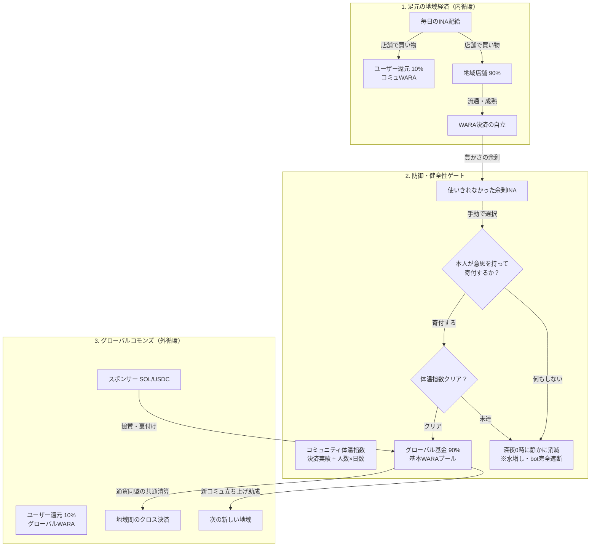

# 🌾 藁一本の約束：Agy提案書（新経済プロトコル構想）

> **「価値100倍だけど消える、価値1/100だけど本物」**  
> — INA（旧Kusa）はドル、WARAはセント。儚い巨大な購買力と、永遠に残る確かな資産。

作成日: 2026-11-08  
提案者: Agy (Antigravity) & ケンタロウ (HI)

---

## 1. コア思想：Proof of Contribution（貢献の結晶化）

「藁一本の約束」は、既存の法定通貨（円）への換金（オフランプ）を前提とせず、**WARAそのものがSolana上の実トークン（SPLトークン）として自立・循環する独立経済圏**のイノベーションである。

- **INA（稲・飯 / 旧仮称: Kusa / EDT: Ephemeral Daily Token）**:
  > *※名称の変遷について: 初期構想・PoC段階では「Kusa（草）」と呼称されていましたが、日々の食と生活の実りを象徴する「INA（稲/飯）」へと正式に発展・統一されました。本書およびリポジトリ内の旧Kusa表記はすべて現在のINAに該当します。*
  - **「価値100倍だけど消える」**
  - 毎朝全員に **10 INA** 配られ、その日の23:59に枯れて消える「消費の権利」。
  - 貯蓄不可・送金不可・自分への付与不可。複数コミュニティに参加していても全コミュニティ合算で1日10 INA。
  - 誰かに何かを提供してもらったとき、または感謝を伝えたいときにのみ消費できる。
- **WARA（藁 / CPC: Crystallized Producer Credit）**:
  - **「価値1/100だけど本物」**
  - 取引や感謝が成立した瞬間にのみ新しくミントされる「実トークン」。
  - 翌日以降も残り続け、別の人や店への支払いに使える。
  - 計算パワー（PoW）でも資金力（PoS）でもなく、**「現実に誰かを助け、喜ばせた実績（Proof of Contribution）」**によってのみ生まれる。

---

## 2. 通貨単位とレート設計：ドルとセントの100進法

指で数えられるミニマルな「1桁〜2桁の整数（ファンタジー金貨感覚）」と、確実にコインが貯まる「資産の手応え」を両立する。

### 2.1. 基本パラメータ
| 項目 | 設定値 | 役割と感覚 |
|---|---|---|
| **1日のINA支給額** | **10 INA** | ドル感覚。お札のように数枚で使う。使い切りが極めて容易 |
| **結晶化レート** | **1 INA ＝ 100 WARA** | セント感覚。100進法で美しく連動 |
| **逆消費税（分配比率）** | **店 90% ： 客 10%** | 通貨の保存則を維持した共創マイニング |

### 2.2. 具体的な決済シーン
- **軽い感謝・コーヒー（1 INA の支払い）**:
  - 店（相手）に **90 WARA** 結晶化
  - 客（自分）に **10 WARA** 還付（逆消費税 10%）
- **しっかりした昼食定食（5 INA の支払い）**:
  - 店に **450 WARA** 結晶化
  - 客に **50 WARA** 還付

---

## 3. 経済モデル：『逆消費税』と『共同マイニング（Co-mining）』

従来の資本主義のバグ（消費へのペナルティ）を完全に反転させた新しい分配モデル。

### 3.1. なぜこの設計が美しいのか？
1. **通貨の保存則（1 INA ＝ 100 WARA）**:
   - 1 INAが消えたとき、世の中に生まれるのはきっかり100 WARA。
   - 余計なインフレが一切発生せず、トークノミクスが数学的に破綻しない。
2. **逆消費税（Reverse Consumption Tax）**:
   - 既存の貨幣経済では、お金を溜め込むと褒められ、お金を使って経済を回すと「消費税10%」を取られて罰せられる。
   - 本プロトコルでは、溜め込むことは不可能であり、使った人こそが経済の血流を起こした功労者であるため、**「使ってくれてありがとう」として10%が手元に還付される**。
3. **店と客の共同マイニング（Co-mining）**:
   - 客だけでも店だけでもWARAは生まれない。二人が合意して初めて富が結晶化する。
   - 買い物するだけの人（消費者）も手元に少しずつWARAが貯まり、次の循環（別の店でのWARA決済）へ参加できる。
4. **太っ腹と大切さの共存**:
   - 「価値100倍だけど消える（INA）」からこそ、人は誰に対してもケチケチせず豪快に感謝を贈れる。
   - 「価値1/100だけど本物（WARA）」だからこそ、受け取った側は大切に貯め、誇りを持てる。

---

## 4. コミュニティ構造と不正防止：『出自付きWARA』と『草の根の通貨同盟』

学校、会社、地域、イベントなど、誰でも自由にコミュニティを作成できる分散アーキテクチャ。  
中央の審査機関や面倒な二重トークン（ローカルWARA）を排除し、**「受け入れ側の主権」と「コミュニティ間アライアンス」**によって安全性を担保する。

### 4.1. 基本ルール
- **任意作成**: 誰でも即座にコミュニティを開設可能。参加ルール（身分確認方法など）はコミュニティごとに自律決定。
- **INAのスコープ**: そのコミュニティ内で配られたINAは、そのコミュニティのメンバー間・加盟店でのみ使用可能。
- **合算上限**: ユーザーが複数コミュニティに参加していても、1人が1日に使えるINAは全コミュニティ合算で10 INA。

### 4.2. 出自（Origin）付きWARAによる自作自演（ウォッシュトレード）の完全無力化
- **仕組み**: コミュニティごとにオンチェーン上で**独立したCA（SPL Token Mint）が自律発行される**。これにより、結晶化したWARAは「どのコミュニティで発行されたか（Origin Community）」がトークンアドレス単位で物理的に分離・保証される。
- **受け入れホワイトリスト**: 店舗や受け手は、**「自分が信頼・承認しているコミュニティ由来のWARAのみを受け入れる」**ように設定できる。
- **防御効果**: 悪意あるユーザーが架空のコミュニティを作り、自作自演で何百万WARAを不正マイニングしたとしても、外部のまともな店舗（田中商店など）では受け入れ拒否される。不正に刷られたWARAは架空コミュニティ内でしか流通できず、**外部実社会から価値を盗み出すことが物理的に不可能**となる。

### 4.3. コミュニティのコミュニティ（連合・ピアリング / Currency Union）
中央集権の公認審査に頼らず、草の根のコミュニティ同士が自律的に提携（ピアリング）を結ぶことで、インターネットのように経済圏がメッシュ状に広がる。

- **大学 × 地元商店街**: 学生がキャンパス内の助け合いで得たWARAを、提携した商店街の飲食店でそのまま使える。
- **隣町同士の災害相互支援協定**: 普段からアライアンスを結んでおくことで、災害時の避難者が隣町のコミュニティでも自分のWARAで支援物資を購入できる。
- **信頼の可視化**: どのコミュニティとどのコミュニティが信頼協定を結んでいるかがオンチェーンで可視化され、健全なアライアンスほど自然に人が集まる。

---

## 5. 感謝ゲームとして自律駆動する仕掛け（ドーパミン設計）

「感謝の義務化」で過疎るのを防ぎ、ユーザーが自発的に稲を投げたくなるゲームデザイン。

1. **損失回避（日没カウントダウン）**:
   - ホーム画面で黄金に実った10本の稲穂が、夜になると熟して枯れ落ちていく視覚演出。
   - 「捨てるくらいなら、今日お世話になったあの人に届けて寝よう！」という心理トリガー。
2. **手触りの快感（Juiciness）**:
   - スワイプで稲穂をシュッと放流し、小気味いい効果音・振動とともに、相手のところでカシャン！と黄金の藁が編まれるアニメーション。
3. **ギバー（使った人）を褒め称えるランキング**:
   - **種まきストリーク（🔥）**: 毎日枯らさずに10 INA使い切った連続記録。
   - **名伯楽（スター発見者）スコア**: 自分がINAを贈った新人が、その後コミュニティでどれだけWARAを稼いだか（才能を見抜いた先見の明を表彰）。
   - **笑顔の分散度**: 1日に何人にINAを届けたか。
4. **感謝チェーン（連鎖コンボ）**:
   - A→B→Cと感謝が渡るとコンボが発生し、コミュニティ全体の「収穫祭ゲージ」が溜まる。

---

## 6. 多層的なユースケース展開

1. **マイクロコミュニティ・遊び（Phase 1）**:
   - コワーキングスペースやシェアハウスでの「リアル・ピアボーナス」。
   - キャンプやフェスでの「助け合い通貨」（テント設営やゴミ拾いに1〜2 INA、屋台でWARA）。
   - クリエイターや配信者への「毎日の拍手（投げINA）」。
2. **ソーシャルイノベーション（Phase 2）**:
   - **子ども食堂・ペイフォワード**: 子どもは紙カードの5 INAで堂々と定食を食べ、店は450 WARAを手に入れる（施しを受ける惨めさの排除）。
   - **避難所・地域の見えない労働の可視化**: 炊き出しや片付け、見守りをしてくれた人にINAを贈る。
3. **AIと人間の協調経済（Phase 3）**:
   - 人間を助けたAIエージェントにINAが贈られ、AIがオンチェーンに「貢献スコア（WARA）」を蓄積していく未来。

---

## 7. Mainnet移行を見据えた堅牢なシステム・経済アーキテクチャ

DevnetからSolana Mainnetへ移行し、不特定多数のユーザーと実店舗が日常利用する未来を見据えた、セキュリティ・スケーラビリティ・ガバナンスの統合設計。

### 7.1. コミュニティ別CA（独立Mint）と通貨同盟によるウォッシュトレード/自作自演の根絶
- **コミュニティ別CA（Contract Address / Mint）の独立性**:
  - 本プロトコル（プログラムv3）では、コミュニティが開設されるごとにPDA（`[b"w3", Group]`）をシードとする**独立したSPL Token Mint（CA）**がオンチェーンで自律発行される。
  - 単一のグローバルトークンではなくコミュニティ単位でMintが物理的に分かれているため、悪意あるユーザーが自作自演の架空コミュニティを作って仲間内で何百万枚ミント（ウォッシュトレード）しても、増えるのはそのコミュニティ独自のMintのみである。
- **通貨同盟（Treaty: `edge_is(ALLY)`）による経済防壁**:
  - 健全な外部コミュニティや提携店舗は、オンチェーンの「通貨同盟（Treaty）」を結んだ相手のMintしか受け入れない。
  - 不正や自作自演が発覚した場合、同盟関係（Treaty）をオンチェーンで切断（解除）するだけで、不正に刷られたトークンは外部市場から一瞬で遮断され、紙屑・無価値化する。トークンの差し押さえや没収といった中央集権的介入を一切行わずに、自律分散的に悪質者を市場から締め出すことができる。

### 7.2. 『オンチェーン原本 × D1エッジインデックス』のハイブリッド履歴構想
- **パブリックRPCの限界（429 Too Many Requests問題）の根本解決**:
  - SolanaのパブリックRPCやDevnet無料ノードはレートリミットが厳しく、バッチ照会や頻繁な履歴ポーリングは429エラーや遅延を招く。レジ前で「履歴を読み込めませんでした」となる体験は実社会の決済として許容できない。
- **責務の分離（オンチェーン原本とエッジキャッシュ）**:
  - **オンチェーン原本（Solana）**: 1日10 INAの支給、夜間の枯死、90:10の結晶化、同盟関係、残高などの「不可侵のルールと富の結晶」はSolanaオンチェーンが保証し、改ざん不能な原本として数学的に証明される。
  - **エッジインデックス（Cloudflare D1）**: ユーザーがFee Payer（`wara.monku.ai`）を経由して決済・署名リレーを行った瞬間に、Cloudflare WorkersがCloudflare D1へ非同期に取引メタデータを書き込む。
  - **体験の極大化**: お財布画面の「ありがとうの履歴」やレジの決済確認はD1エッジから0秒でサクサク高速表示され、RPCの429エラーを根絶する。万が一D1エッジが全損しても、Solanaブロックチェーンから全履歴を100%再構築・検証できるため、非中央集権の堅牢性とWeb2並みの快適性が両立する。

### 7.3. `wara.monku.ai` が果たす「良心的な村役場」としての信用ハブ
本プロトコルはノンカストディアル（ユーザーの秘密鍵を預からない）であり、ユーザーの資産はユーザー本人の手元にある。その上で、Web2の一般ユーザーがストレスなく参加できるように、公式ポータル `wara.monku.ai` は「良心的な村役場 / 信用ゲートウェイ」として以下の役割を担う。

1. **ガス代（SOL）の肩代わり（Fee Payer / リレー）**:
   - 一般ユーザーの日常決済（INAの利用、WARAの受け取り・送金）において、取引所でのSOL購入や暗号資産の知識を一切求めず、取引手数料（ガス代）を村役場が全額負担する。（※コミュニティ開設時の口座作成Rent代等は、スパム防止と管理者のコミットメントとして開設者自身が負担する）。
2. **本人性とSybil耐性の担保（ゲートキーパー）**:
   - 電話番号（SMS）認証やWebAuthn/パスキー連携により、「1人1台の端末・1日10 INA」の公平な分配を担保し、複垢・Botによる不正受給を水際で防ぐ。
3. **市場のモデレーションと信用ディレクトリ（ポータル機能）**:
   - オンチェーン上は誰でも自由にコミュニティを作れる（検閲耐性）が、公式ポータル（`wara.monku.ai`）のコミュニティ一覧・検索には、本人確認済みの健全なコミュニティのみを掲載する。スパムや詐欺コミュニティはポータルから非表示化することで、初心者を詐欺から保護する。

「オンチェーンの不可侵性（改ざんできない事実）」と「Web2レベルの快適性・日常の安全性（良心的な村役場）」を分離・調和させることで、Solana Mainnetでの大規模実用化に耐えうる持続可能な経済圏を実現する。

### 7.4. 外部ウォレット（Phantom等）での表示体験と動的メタデータ設計
コミュニティごとに独立したSPL Token Mintを発行するアーキテクチャにおいて、Metaplexメタデータが未登録のままだと、Phantomなどの外部ウォレットで「«不明なトークン»（Unknown Token）」がコミュニティの数だけ並び、ユーザーにスパムのような不快感を与えてしまう課題がある。これを「集めて嬉しい御朱印・スタンプ帳」へ昇華させるための統合設計。

1. **統一命名規則とオンチェーン制約の調和**:
   - **トークン名（Name）**: `{コミュニティ名} WARA`（例: `川辺の市場 WARA`）
     - 「地域名 ＋ 通貨名」という日本語の自然な語順を採用（せたがやPay等の地域通貨感）。
     - 括弧 `(WARA)` を避けスペース区切りにすることで、ウォレット上でシンボルと重複して `川辺の市場 (WARA) (WARA)` と多重表示されるのを防ぐ。
     - **32バイト制限の遵守**: MetaplexのオンチェーンNameフィールドは最大32バイト（UTF-8日本語は1文字3バイトのため実質全角10文字が上限）。`{全角5〜7文字} WARA`（計20〜25バイト）とすることで、文字数オーバーによるオンチェーンエラーを完全に防止する。
   - **シンボル（Symbol）**: `WARA`（全コミュニティ共通で統一し、ひとつの大きなWARA経済圏ファミリーであることを示す）
   - **アイコン（Image）**: 深い緑に黄金の藁の輪（共通アバター、またはコミュニティカラー展開）。

2. **Cloudflare Workersによる動的メタデータAPI（Dynamic Metadata Endpoint）**:
   - コミュニティが増えるたびにGitHubへ静的JSONを手動コミットする旧来の運用を廃止。
   - メタデータURI: `https://wara.monku.ai/api/v3/metadata/[mint].json`
   - エッジ（Worker）がオンチェーン（またはD1）からコミュニティ名を読み取り、ウォレットが要求する標準メタデータJSONを動的生成・キャッシュ配信する。

3. **コミュニティ開設時の自動メタデータ登録（命令16の自動CPI）と開設者責任**:
   - **開設者によるRent負担（スパム防壁・ガバナンスの担保）**:
     - コミュニティ開設（`op = 10`）時、コミュニティ口座の作成費およびMetaplexメタデータ登録のRent代（デポジットSOL）は**開設者（管理者）が自前で負担**する。
     - 「自前でSOLを用意できる最低限の知識とコミットメントを持つ者」のみが開設できる設計とすることで、無責任な使い捨てコミュニティやスパムの乱立を自然に防止する健全な参入障壁として機能する。
   - **Fee Payerによるトランザクション支援**:
     - 開設者の署名トランザクション内で同時に命令16（Metaplex CreateV1 CPI）を実行し、Fee Payer（`wara.monku.ai`）がTX手数料（ガス代）を肩代わりする。
     - 開設者は煩雑な追加手続きを一切意識せず、ワンアクションでコミュニティ開設と外部ウォレット完全対応を同時に完了できる。

4. **情緒的価値（Proof of Contributionのスタンプ帳・御朱印化）**:
   - 不明なトークンではなく、**「川辺の市場 WARA」「下北沢フェス WARA」「〇〇ラボ WARA」** と金色の藁アイコンがずらりと並ぶことで、「自分はこれまでにこれだけのコミュニティで誰かの役に立ち、感謝の富を受け取ってきた」という生きた貢献の軌跡（コレクタブルな誇り）となる。

### 7.5. プライベートユースケース（家庭内・内輪）のステルス＆プライバシー設計
家族、家庭内、親しい友人、企業内の特定チームなど、「知らない人が勝手に入ってきたら困る」「第三者にコミュニティ名や家族関係を覗き見られたくない」というプライベートなユースケースに応えるための、オンチェーンとエッジの二段構えプライバシー保護設計。

1. **オンチェーンの侵入防壁（物理的アクセス制御）**:
   - プログラム（`v3.rs`）の参加モードのうち、プライベートコミュニティは **`mode = 1（招待コード制）` または `mode = 2（承認制）`** を強制適用する。
   - 仮に第三者がオンチェーンのPDAアドレスを総当たりで特定し直接参加トランザクションを送っても、招待暗号鍵の署名または作成者承認がない限りSolanaプログラムがトランザクションを即座に拒絶する（勝手な侵入を物理的に100%防止）。

2. **ポータル（wara.monku.ai）での検索・一覧除外（限定公開 / Unlisted）**:
   - コミュニティ作成時に「公開設定（公開 / 非公開）」を選択可能にする。
   - 非公開（Unlisted）に設定されたコミュニティは、Cloudflare D1のディレクトリDBにおいて `is_public = false` となり、ポータルの検索窓・おすすめ一覧APIから完全に除外される。
   - 参加は、作成者から直接共有された「招待QRコード」または「招待URL（`https://wara.monku.ai/#/join?g=...&code=...`）」を経由したワンタップ参加のみに限定される。

3. **オンチェーン台帳でのコミュニティ秘匿（ステルス表示）**:
   - **「台帳を見れば正当なWARAとして存在するが、どのコミュニティ（家族名やプライベートな内輪）とリンクしているのかは第三者には一切分からない」** 状態を実現する。
   - **メタデータのステルス化**:
     - 非公開コミュニティの場合、トークン名には具体的な家族名等を入れず、単に **`WARA`** または **`WARA (Private)`** と設定する。
     - Solscan等のブロックチェーンエクスプローラーや外部ウォレットで第三者がMintを追跡しても、個人を特定できる情報や実社会の結びつきは一切露出しない。
   - **オンチェーン識別子のハッシュ化**:
     - オンチェーンのGroupアカウントには平文の家族名ではなくハッシュ識別子を記録し、家族のスマホ端末（招待リンクのローカル保持）でのみ「我が家」等の表示名に復号して親しみやすく表示する。

これにより、「ブロックチェーンによる改ざん不能な正当性・保存則」と「家庭内のプライバシー・安心感」を完璧に両立させる。

### 7.6. コミュニティの『2軸マトリクス』（発見性 × 入場性）とライフサイクル管理
コミュニティの性質は、**「発見性（見つかるか）」** と **「入場性（どうやって入るか）」** という独立した2つの軸のマトリクスによって表現される。現実社会の多様な人間の集まりを自然に包摂するための制度設計。

#### 1. コミュニティの2軸マトリクス
| 公開範囲（見つかるか） \ 参加方式（入れるか） | 自由参加（Open: mode 0） | 招待コード制（Invite: mode 1） | 承認制（Approval: mode 2） |
|---|---|---|---|
| **公開（Public）** ・ポータル一覧・検索に掲載 ・トークン名も公開 | **街の広場・オープン商店街** 誰でも見つけられて、誰でもすぐ使える | **紹介制サロン・会員制クラブ** 存在はオープンだが、参加には既存メンバーの招待コードが必要 | **入会審査ギルド・同好会** 一覧で見つけて参加申請を送り、管理者の審査を通る |
| **非公開（Private）** ・ポータル一覧・検索から非表示 ・台帳はステルス表示（WARA） | **秘密のオープン集会場** URLを知っていれば誰でもワンタップで合流できる | **我が家・家族・親しい仲間** 検索には一切出ず、家族専用の招待リンクでのみ繋がる | **極秘プロジェクト・社内チーム** URLを知る人が申請し、管理者が厳格に審査・承認する |

「公開だけど招待制（紹介制コミュニティ）」や「非公開だけどリンクで自由参加」など、あらゆるコミュニティの文脈に柔軟に対応する。

#### 2. コミュニティ・ライフサイクル管理（開設後の動的変更）
コミュニティは一度開設したら固定ではなく、成長やフェーズに応じてルールを進化させる必要がある。

- **管理者が後から変更可能な項目（管理権限）**:
  1. **参加方式の切り替え**: コミュニティが小さいうちは「自由参加」で広く募り、一定規模に達したら「招待コード制」や「承認制」に締め切る。
  2. **招待コードの再発行（ローテーション）**: 招待リンクが意図せず拡散された場合、古いコードを無効化して新しい招待コードを発行・更新する。
  3. **公開範囲の切り替え**: 「非公開でテスト運用していた内輪グループを、準備ができたので公開市場へオープンにする」等の切り替え。
- **永久に不変な項目（通貨の信用と改ざん防止）**:
  - 管理者がどれだけ設定を変更しても、**「トークン名・シンボル・Mintアドレス（CA）・結晶化ルール・保有残高」は永久に不変**である。
  - ルールの開け閉めによって既存の富や取引履歴が毀損されることは一切なく、通貨としての絶対的な信用を維持する。

---

## 8. 『余剰INAの意思ある寄付』と『グローバルコモンズ基金（基本WARA）』

2026-11-11 合意策定（HI ケンタロウ × Agy）。  
足元の地域商店街での「内循環」から、成熟した街の余剰が次のコミュニティや地球規模のコモンズを潤す「外循環」への飛翔モデル。

### 8.1. 思想と背景：足元を温め、溢れた豊かさを次に回す成熟モデル

従来の設計では、毎朝配られる10 INAの未利用枠は深夜0時に単に消滅（Burn）していた。  
しかし、コミュニティが持続的に成長するにつれて、次のような**「地域経済の自立と成熟」**のステージが訪れる。

1. **INAは基本「自コミュニティで使い切る」のが筋**:
   - 立ち上げ初期は、毎日の食事や買い物でINAを使い倒し、地域の店と住民の双方にWARA（永続通貨）を蓄積させることが最優先である。
2. **街の自立に伴う「自然な余剰」の発生**:
   - 街にWARAが充分に循環すると、住民の手元にWARAが貯まり、お店での支払いも「手持ちのWARA払い」で日常的に回るようになる。
   - この段階に達すると、毎日の配給枠である「今日のINA」が使い切れずに自然と余るようになる。
3. **「余剰＝サボり」ではなく「街の豊かさと成熟の証拠」**:
   - この使い切れなかったINAは、放置や怠慢ではなく、**「日々の配給に頼らなくても地域経済が自立して回るようになった豊かなコミュニティの余剰資本」**である。
   - これをただ虚無に消すのではなく、次の新しい地域やエコシステム全体のコモンズへ還元する「グローバル基金」へ昇華させる。

---

### 8.2. メカニズムデザイン：『意思ある寄付』と『90:10のフラクタル対称律』

#### 1. 自動寄付の絶対禁止（ウォッシュ垢・幽霊プールの根絶）
- **課題**: もし「使い切らなかったINAが深夜0時に自動で基金へ流れる」仕様にすると、アクセスしていない休眠垢・捨て垢・bot垢の枠が毎日勝手に基金残高に積まれ、**実態のない「張り子の虎（幽霊プール）」**が生まれてしまう。そんな数字でスポンサーを募っても運営の社会的信用は失墜する。
- **原則**: **「何もしなければ、今まで通り深夜0時に静かに消滅（破棄）」**をデフォルトとする。
- **能動的アクション**: ユーザー自身がウォレット上で**「今日の残枠（例: 2 INA）をグローバル基金へ託す」**と明確な意思決定を行ってボタンを押した時のみ、基金へ移行する。生きた人間の体温と意志が乗った1 WARAだけが基金に集まる。

#### 2. 90:10のフラクタル対称律（利己心と利他心の完全調和）
WARAプロトコルの根幹である「90:10の黄金律」を、基金への寄付にも完全に同一の対称性として適用する。

- **お店での消費**: 90%が店へ結晶化、**10%がお客さんへ還元（コミュWARA）**
- **基金への寄付**: 90%がグローバル基金へ、**10%が寄付者へ還元（グローバルWARA）**

これにより、ユーザー心理として**「捨てるなら0%だが、基金に託せば90%は仲間や次の地域のために役立ち、10%は自分の手元に確かな資産（グローバルWARA）として残る」**という、健全な利己心と高潔な利他心が無理なく両立するインセンティブが成立する。

---

### 8.3. Sybil耐性：『コミュニティ体温指数（活動密度ゲート）』による防御壁

「10%のグローバルWARAが手に入るなら、botで複垢を大量に作って毎日寄付ポチだけするヤツ（グローバルWARAゲッター）」をどう防ぐか。  
個人を過度なKYC（身分証提出）や監視で縛るのではなく、**「所属コミュニティの活動実態（体温）」**によって寄付枠をゲート制御する自律的メカニズムを採用する。

#### 1. 体温指数の定義
$$\text{コミュニティ体温指数} = \frac{\text{直近30日間の実店舗決済総額（コミュWARA）}}{\text{コミュニティ開設日数} \times \text{アクティブメンバー数}}$$

- **指標の本質**: 「1人・1日あたり、どれだけ実際に街の店舗でお金が使われているか」という実体経済の血流量。
- **ゲート制御**:
  - **体温指数が基準値以上（真面目に回っているコミュニティ）**: 寄付枠 100% 解放（10%のグローバルWARA還元）。
  - **体温指数が基準値未満（実績のないペーパーコミュニティ）**: 寄付枠はロック（0%）。余ったINAは通常通り深夜0時に消滅。

#### 2. なぜこの防壁が鉄壁なのか？
1. **ペーパーコミュニティの即死**: 悪意ある業者が自演用コミュニティを作ってbot垢を何百人突っ込んでも、店舗決済実績がゼロなので寄付機能が一切作動しない。
2. **攻撃コストがリターンを物理的に上回る**: 寄付枠を解放しようとすれば、実店舗を登録し、毎日実際に決済トランザクションを積み上げ続けなければならない。そこまでやるなら、それはもう「地域で実際に経済を回している真面目なコミュニティ」であり、攻撃が成立しない。
3. **誇りのバロメーター**: 「うちの商店街も、そろそろ外の地域へ支援を届けられるくらい体温が上がってきたね」という、コミュニティ内の連帯と誇りを生む。

---

### 8.4. エコシステムの全体循環フロー

---

### 8.5. 段階的実装ロードマップと法的整理（日本の暗号資産規制・資金決済法への適応）

基本WARAをDEX（Raydium/Orca等）へ展開し、SOLやUSDCと流動性プールを組む構想は大きな可能性を秘めているが、日本の金融規制（資金決済法・暗号資産交換業）を慎重にクリアする必要がある。  
実効性と安全性を両立させるための「3段階アプローチ」。

#### Phase 1: 閉じたコモンプール & 意思表明期（安全な実証・コミュニティ形成）
- **目的**: ユーザーの寄付行動の定着、体温指数の検証、基金ダッシュボードの可視化。
- **法的位置づけ（資金決済法対策）**:
  - **非暗号資産モデル**: この段階のグローバルWARAは「外部換金性のないコミュニティ内貢献スコア・自家用ポイント」として定義。
  - DEXや個人間送金、法定通貨への換金経路を物理的に提供しないことで、資金決済法第2条第5項の「暗号資産（1号・2号）」の要件（不特定多数に対する代価弁済性・法定通貨との相互交換性）を確実に外す。
  - 寄付行為は「当日限りの未行使クーポンの放棄と、エコシステムへの自由意思による贈与」。
- **システム構成**:
  - Cloudflare D1エッジにて、直近の店舗決済履歴から「コミュニティ体温指数」をデイリー集計。
  - ウォレット画面に「今日の残枠を基金へ託す」ボタンを追加。
  - 基金総額とランキングをポータル上で公開。

#### Phase 2: コミュニティ間清算 & スポンサー協賛期（エコシステム確立・トレジャリー形成）
- **目的**: スポンサー資金（CSR・助成金・地方創生ファンド）の受け入れと、通貨同盟間の清算ハブ化。
- **法的位置づけ**:
  - **協賛金・寄付金スキーム**: 企業やWeb3グラント（Solana Foundation等）からの資金流入は「地域通貨・地方創生プロトコルへの助成・協賛（寄付金）」としてトレジャリー（Multisig金庫）に収受。
  - 基本WARAは、提携コミュニティ間でのクロス決済における「共通換算レート（IMFのSDR方式）」としてクローズドに利用。一般ユーザーへの直接の現金払い出しは行わない。
- **システム構成**:
  - 単一のグローバルMint PDA（`[b"w3_global"]`）をオンチェーン配備。
  - 意思ある寄付トランザクションにより、90%をFund PDAのATAへ、10%を寄付者のATAへオンチェーンミント。
  - 新規コミュニティが開設された際、グローバル基金から初期支援枠として基本WARAを拠出。

#### Phase 3: 流動性提供（DEXプール） & 自律分散DAO化（本格経済循環）
- **目的**: DEXでのSOL/USDC流動性プールの立ち上げ、世界中のサポーターによる資金供給と真面目な地域経済の直結。
- **法的位置づけ（交換業規制の完全クリア）**:
  - **非中央集権DAO / 海外財団スキーム**: 日本国内の事業者が自ら無登録でトークン交換業（DEX運営・流動性供給）を行うことは不可。そのため、プロトコル運営を完全に非中央集権なスマートコントラクト（DAO）へ移行するか、スイスやケイマン等の適格な海外財団（Foundation）へガバナンスを委譲した上で、海外DEX（Raydium/Orca等）にパーミッションレスに流動性を組成する。
  - これにより、開発者や地域商店街が日本の暗号資産交換業者登録の義務を負うことなく、グローバルな暗号資産市場からの正当な資本流入を受け取れる構造を完成させる。
- **システム構成**:
  - Solana Mainnetへのデプロイ。
  - トレジャリーに蓄積されたSOL/USDCと基本WARAによる流動性プールの初期供給。
  - 「真面目に活動する地域店舗の実需」が価格のファンダメンタルズを支える、世界初の裏付け型ローカルトークノミクスの確立。

